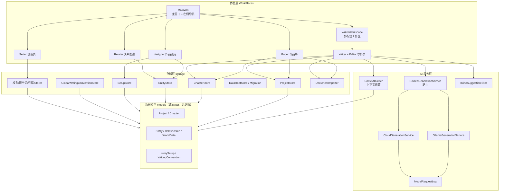

# 01 · 项目架构

## 技术栈

| 项目 | 说明 |
| --- | --- |
| 语言 | C++20（`CMAKE_CXX_STANDARD 20`） |
| UI 框架 | Qt 6.5.3 Widgets（全部 UI 用 C++ 手写，未使用 `.ui` 文件与 Qt Designer） |
| 网络 | Qt6::Network（QNetworkAccessManager，HTTPS 走 Windows Schannel TLS 插件） |
| 构建 | CMake ≥ 4.1，AUTOMOC/AUTORCC/AUTOUIC 开启 |
| 平台 | Windows（MinGW 64-bit 工具链；凭据存储使用 Win32 Advapi32） |
| 目标产物 | 单一可执行文件 `write.exe`（无内部子库，按目录划分逻辑模块） |

## 分层架构

应用是单可执行程序，按"**界面层 → 服务层 → 存储层 → 数据模型**"组织，依赖方向自上而下、单向：



设计要点：

1. **models 目录是纯数据**：`struct Chapter / Project / Entity / Relationship / storySetup` 等不含业务逻辑、不继承 QObject，可被任何层引用而不产生反向依赖。
2. **storage 是唯一接触磁盘的层**：全部为静态函数的"Store"命名空间式类，签名统一为 `load/save(..., QString &error)` 返回 `bool`。
3. **AI 服务层与 UI 解耦**：`GenerationService` 抽象基类以信号（`generated/failed/availabilityChanged`）回报结果，`Writer` 只依赖抽象，通过 `RoutedGenerationService` 在本地/云端实现间切换。
4. **跨页同步走信号**：当前作品变化、作品信息变化、全局约定变化、模型可用性变化各有专属信号链（见 [02-模块职责](02-模块职责.md)）。

## 目录结构

```
write/
├── CMakeLists.txt              # 构建脚本（源文件列表 + Qt 部署 POST_BUILD）
├── main.cpp                    # 入口：初始化 QApplication、读取数据根目录、启动 MainWin
├── MainWin.{h,cpp}             # 主窗口：左侧导航 + QStackedWidget 工作区 + 模型状态徽标
├── resources.qrc               # 图标等资源
├── app-icon.rc / assets/       # Windows 应用图标
│
├── models/                     # 纯数据结构
│   ├── Project.h               #   Chapter / Project
│   ├── Entity.h                #   Entity（人物/地点/组织/物件）
│   ├── Relationship.h          #   Relationship（双向关系）
│   ├── WorldData.h             #   WorldData（Entity + Relationship 集合）
│   ├── StorySetup.h            #   WritingConvention / storySetup + 生效约定规则
│   └── dialogs/                #   CreateProjectDialog（新建/编辑作品弹窗）
│
├── storage/                    # 持久化层（全部静态函数）
│   ├── StoragePaths.h          #   磁盘路径常量与拼接（单一事实来源）
│   ├── AppSettings.h           #   QSettings 入口（INI，"WriterStudio/WriterStudio"）
│   ├── DataRootStore.{h,cpp}   #   作品库根目录设置
│   ├── DataRootMigration.{h,cpp} #  作品库整库迁移（校验→复制→验证）
│   ├── ProjectStore.{h,cpp}    #   project.json 读写
│   ├── Chapter/ChapterStore.*  #   章节正文 .md 与 .bak 读写
│   ├── SetUp/SetupStore.*      #   setup.json 读写
│   ├── EntityStore/EntityStore.* # entities.json 读写
│   ├── GlobalWritingConventionStore.* # 全局写作约定
│   ├── DocumentAbout/DocumentImporter.* # TXT 解析（章节切分、书头解析）
│   ├── ModelServiceIdentity.h  #   当前模型身份（key/显示名/服务类型）
│   ├── ModelSettingsStore.*    #   Ollama 地址与模型（QSettings）
│   ├── CloudProfileStore.*     #   云端配置列表（QSettings）
│   ├── CloudCredentialStore.*  #   API Key（Windows 凭据管理器 CredReadW/CredWriteW）
│   ├── ActiveModelServiceStore.* # 当前使用 Ollama 还是云端
│   ├── InlinePromptSettingsStore.* # 用户自定义系统提示词
│   └── InlineSuggestionSettings.*  # 行内建议总开关
│
├── WorkPlaces/                 # 界面层（每个工作页一个子目录）
│   ├── workingPaper/           #   Paper 作品库页 + ArchiveDialog + ImportPreviewDialog
│   ├── WritePaper/             #   Writer 写作页 + Editor 编辑器 + WriterWorkspace 标签容器
│   ├── DesignPaper/            #   designer 设定页 + CreateEntityDialog
│   ├── RelationPaper/          #   Relater 关系图谱 + CreateRelationshipDialog
│   ├── SettingPaper/           #   Setter 设置页 + ModelDebugDialog（请求记录查看器）
│   ├── ContextBuilder/         #   AI 上下文组装（无 UI）
│   └── Generation/             #   AI 生成服务（详见 03 文档）
│       ├── GenerationService.h #     抽象基类
│       ├── RoutedGenerationService.* # 本地/云端路由
│       ├── OllamaGenerationService/  # Ollama 实现
│       ├── CloudGenerationService.* + CloudChatApi.* # OpenAI 兼容实现
│       ├── InlinePrompt.*      #     提示词模板
│       ├── InlineSuggestionFilter.*  # 回复清洗过滤
│       ├── ModelRequestLog.*   #     内存请求日志
│       └── MockGenerationService.*   # 测试桩
│
├── static/                     # 项目文档：wiki、设计原型、指南、日志、计划、交接和打包说明
└── WriterStudio/               # 默认数据根目录（作品 JSON + 章节正文，用户数据非代码）
```

## 关键数据流

### 打开一部作品

```
Paper(双击作品) → openProjectRequested(projectId)
  → MainWin::openProject
      → WriterWorkspace::openProject(projectsPath, id)
          → 新建/复用 Writer，Writer::openProject()
              → ProjectStore::loadProject(project.json)
              → 逐章 ChapterStore::loadChapter(<id>.md)
      → 同步 projectId 给 designer / Relater（信号 currentProjectChanged）
```

### 一次章节编辑保存

```
Editor::textChanged → Writer::markChapterModified()
  → 2 秒 autoSaveTimer_ → Writer::saveCurrentChapter()
      → ChapterStore::saveChapter()        # 先写 .md
      → ChapterStore 覆盖前轮换出 .bak     # 上一版备份
```

### 一次 AI 行内建议

概览如下（完整细节见 [03-AI行内建议子系统](03-AI行内建议子系统.md)）：

```
停止输入 ~0.8s → suggestionDelayTimer_ 超时 → Writer::requestShortSuggestion()
  → SetupStore/GlobalWritingConventionStore 读取约定
  → ContextBuilder::buildInlineSuggestionContext()
  → RoutedGenerationService::start(GenerationRequest)
      → OllamaGenerationService 或 CloudGenerationService（HTTP POST）
  ← generated(requestId, text)
  ← InlineSuggestionFilter::clean(text) 过滤
  ← Editor::showInlineSuggestion() 灰色渲染 → Tab 接受 / Esc 或任意编辑取消
```

## 模块依赖关系表

| 依赖方 | 被依赖方 | 依赖内容 |
| --- | --- | --- |
| `main` | `DataRootStore`, `StoragePaths`, `MainWin` | 启动顺序：定位数据根 → 确保 projects 目录 → 构造主窗口 |
| `MainWin` | 5 个工作页 + `WriterWorkspace` | 页面切换、模型可用性徽标、专注模式 |
| `Writer` | `ContextBuilder`, `GenerationService`(抽象), `InlineSuggestionFilter`, 各 Store | 触发与消费 AI 建议、章节 CRUD |
| `RoutedGenerationService` | `Ollama/CloudGenerationService`, `ModelServiceIdentityStore` | 按 ActiveModelServiceStore 分发请求 |
| `CloudGenerationService` | `CloudChatApi`, `CloudProfileStore`, `CloudCredentialStore`, `InlinePromptSettingsStore` | 组包、取密钥、发请求 |
| `OllamaGenerationService` | `ModelSettingsStore`, `InlinePromptSettingsStore` | 组包、发请求 |
| `Setter` | 全部模型相关 Store + `ModelDebugDialog` | 模型配置 UI、测试、激活 |
| `designer` | `SetupStore`, `EntityStore`, `GlobalWritingConventionStore` | 设定与人物世界资料编辑 |
| `Relater` | `EntityStore` | 图谱渲染与关系编辑 |
| `Paper` | `ProjectStore`, `ChapterStore`, `DocumentImporter`, `DataRootMigration` | 作品库与导入导出 |
| 所有 storage | `models` + `AppSettings`(QSettings) | 序列化 |

## 外部依赖

| 依赖 | 版本 | 用途 | 备注 |
| --- | --- | --- | --- |
| Qt6::Core | 6.5.3 | 基础类型、QSettings、QJson | `CMAKE_PREFIX_PATH` 指向 `F:/qt/6.5.3/mingw_64` |
| Qt6::Gui | 6.5.3 | 字体、QTextLayout（AI 建议绘制） | |
| Qt6::Widgets | 6.5.3 | 全部 UI | |
| Qt6::Network | 6.5.3 | 两个 AI 服务的 HTTP 请求 | |
| Advapi32 (Win32) | 系统库 | `CredReadW/CredWriteW/CredDeleteW` 管理 API Key | 见 [CloudCredentialStore.cpp](../../storage/CloudCredentialStore.cpp) |
| Qt TLS 插件 qschannelbackend | 6.5.3 | HTTPS | 构建后自动拷贝；使用系统 TLS，无需 OpenSSL DLL |
